# Software Design Document (arc42) – protoreverse

| Feld | Wert |
| --- | --- |
| Projekt | `protoreverse` |
| Dokumenttyp | Software Design Document (SDD) nach arc42 |
| Version | 1.6 |
| Datum | 2026-11-05 |
| Status | Final |
| Grundlage | arc42 Template, Version 9 (arc42.org) |
| Quellcode | `src/`, `tests/`, `CMakeLists.txt` |

Dieses Dokument beschreibt die Architektur von `protoreverse` anhand der zwölf
arc42-Abschnitte. Die Sequenzdiagramme sind als Mermaid-Blöcke eingebettet und
werden von GitHub, GitLab, VS Code (Markdown Preview Mermaid Support) und
anderen Mermaid-fähigen Markdown-Renderern dargestellt.

## Änderungshistorie

| Version | Datum | Autor | Änderung |
| --- | --- | --- | --- |
| 1.0 | 2026-11-04 | Entwicklung | Erstdokumentation inkl. Server-Greeting und Sequenzdiagrammen |
| 1.1 | 2026-11-05 | Entwicklung | Typ-präfixiertes Framing (`type` + `len`) und `--greeting-type` |
| 1.2 | 2026-11-05 | Entwicklung | Verzögertes Greeting mit `--greeting-framing auto` aus dem gelernten Framing |
| 1.3 | 2026-11-05 | Entwicklung | JSON Lines Ausgabe (`--json-output`, `--json-hexdump-bytes`) mit Message-Spool und Wire-zu-JSON-Dekodierung |
| 1.4 | 2026-11-05 | Entwicklung | Erste Client-Nachricht speichern (`--save-first-message <file>`) |
| 1.5 | 2026-11-05 | Entwicklung | Server antwortet automatisch mit der ersten Client-Message (`--reply-with-first-message`) |
| 1.6 | 2026-11-05 | Entwicklung | Periodisches Server-Alive-Keep-alive (`--alive-message`, `--alive-interval`, `--alive-message-type`) als 8-Byte-Header-Frame ohne Payload mit gelerntem Framing |

---

## 1. Einführung und Ziele

### 1.1 Aufgabenstellung

`protoreverse` ist ein kommandozeilenbasiertes Werkzeug, das aus einem
protobuf-Byte-Stream ein best-effort `.proto`-Schema rekonstruiert. Es
unterstützt zwei Betriebsarten:

- **`serve`**: Lauscht auf TCP, akzeptiert beliebig viele Verbindungen und
  analysiert alle eingehenden Datenströme gegen ein gemeinsames, globales
  Schema. Optional sendet der Server ein konfiguriertes protobuf-Greeting –
  sofort bei explizitem Framing oder verzögert nach der Framing-Erkennung.
- **`analyze`**: Liest eine Capture-Datei oder `stdin` einmalig ein und schreibt
  daraus ein Schema.

Der wesentliche Mehrwert liegt in der automatischen Erkennung des Framings.
Protobuf selbst beschreibt nur Felder innerhalb einer Nachricht, nicht die
Länge oder Abgrenzung einzelner Nachrichten. `protoreverse` probiert daher
mehrere Framing-Varianten aus, bewertet sie anhand der dekodierbaren
Nachrichten und sperrt sich auf den plausibelsten Kandidaten. Anschließend
werden Felder, Typen, Wiederholungen, verschachtelte Nachrichten und gepackte
Felder inferiert.

**Wichtige funktionale Anforderungen:**

| ID | Anforderung |
| --- | --- |
| FR-1 | TCP-Server mit mehreren gleichzeitigen Verbindungen und gemeinsamem Schema |
| FR-2 | Offline-Analyse aus Datei und `stdin` |
| FR-3 | Automatische Erkennung gängiger Framing-Varianten sowie manueller Override |
| FR-4 | Parsen und Validieren von protobuf-Wire-Daten inkl. Verschachtelung |
| FR-5 | Best-effort-Schema mit Feldnummern, Typen, `repeated`/`packed`, Konfidenz und Caveats |
| FR-6 | Atomare `.proto`-Ausgabe und periodische Autosaves |
| FR-7 | Optionales, serverseitiges Greeting pro Verbindung |
| FR-8 | Kontinuierliche Verarbeitung ohne vollständiges Laden des Streams |

**Wichtige nicht-funktionale Anforderungen:**

| ID | Anforderung |
| --- | --- |
| NFR-1 | Nur Boost (Header) und C++20; keine Abhängigkeit von `protobuf`, `protoc` oder generiertem Code |
| NFR-2 | Begrenzter Speicher- und Rechenaufwand auch bei langen Streams und vielen Verbindungen |
| NFR-3 | Robustheit gegen malformed Daten; kontrollierte Fehlerbehandlung statt Absturz |
| NFR-4 | Nachvollziehbare Ergebnisse durch Konfidenzwerte, Kandidaten-Logging und Caveats |
| NFR-5 | Einfacher Betrieb: ein Binary, CLI-Konfiguration, Logs auf `stdout`, sauberes Herunterfahren per Signal |
| NFR-6 | Keine stillen Teil-Dateien: `.proto`-Ausgabe ist atomar |

### 1.2 Qualitätsziele

Die folgenden Qualitätsziele sind für die Architektur entscheidend:

1. **Korrektheit der Wire-Verarbeitung**: Protobuf-Felder müssen exakt nach
   Wire-Spezifikation gelesen, validiert und weitgehend verlustfrei
   weitergereicht werden.
2. **Robustheit**: Unbekanntes Framing, beschädigte Frames und bösartige Längen
   dürfen den Prozess nicht unkontrolliert beenden oder unbegrenzt Speicher
   belegen.
3. **Erklärbarkeit**: Da die Inferenz heuristisch ist, müssen Unsicherheiten
   sichtbar sein (Konfidenz, Kandidaten, Alternativen, RAW-Warnungen).
4. **Betreibbarkeit**: Ein einzelnes Binary, klare CLI, deterministische
   Ausgabe, Logs und Signalbehandlung.
5. **Streaming-Fähigkeit**: Verarbeitung in Chunks, ohne den gesamten Stream
   vorzuhalten.

### 1.3 Stakeholder

| Stakeholder | Interesse | Sicht auf das System |
| --- | --- | --- |
| Reverse-Engineering-/Security-Analyst | Protokollverständnis aus Captures | Nutzt CLI, erwartet plausible Schemata und Caveats |
| Integrationsentwickler | Bestätigung eines vermuteten Framings | Nutzt explizites Framing, Greeting und Logs |
| Operator | Stabiler Dauerbetrieb | Startet `serve`, überwacht Logs, beendet per Signal |
| Maintainer | Wartbarkeit und Nachvollziehbarkeit | Nutzt arc42-Dokument, Tests und klare Modulgrenzen |
| Auftraggeber | Keine zusätzlichen Laufzeitabhängigkeiten | Prüft Boost-only-Constraint und Build-Reproduzierbarkeit |

---

## 2. Randbedingungen

### 2.1 Technische Randbedingungen

| Randbedingung | Ausprägung | Konsequenz |
| --- | --- | --- |
| Sprache | C++20 | `std::span`, `std::bit_cast`, Concepts-freie moderne Standardbibliothek |
| Build | CMake ≥ 3.20 | Einheitlicher Build für Linux/MSVC |
| Abhängigkeiten | Boost ≥ 1.74 (Header), Threads | Kein `protobuf`, `protoc`, keine Codegenerierung |
| Netzwerk | Boost.Asio (TCP) | Ein `io_context`, asynchrone Accept-/Read-/Write-Operationen |
| Plattform | POSIX/Linux | `localtime_r`, POSIX-Signale, Dateisystem-Semantik |
| Compiler | Getestet mit GCC 16 | C++20-Features und Warnungen (`-Wall -Wextra -Wpedantic`) |
| Persistenz | Keine Datenbank | Schema lebt im Prozess; Ausgabe ist ein Snapshot |
| Protokoll | Protobuf-Wire-Format | Keine selbstbeschreibenden Namen, Enums, Oneofs oder Signedness |
| Sicherheit | Keine TLS-/Auth-Schicht | Nur für vertrauenswürdige Netze gedacht |

### 2.2 Organisatorische Randbedingungen

- Das Projekt liegt als eigenständiges CLI-Projekt ohne Server-Backend vor.
- Es gibt keine externe Konfigurationsdatei; alle Einstellungen kommen über
  Kommandozeilenargumente.
- Das Workspace-Verzeichnis ist kein Git-Repository; Änderungen werden direkt
  auf dem Dateisystem gehalten.
- Die Testsuite ist ein einzelnes ausführbares Programm mit eigener
  `CHECK`-Makro-Infrastruktur und kann über `ctest` eingebunden werden.

### 2.3 Konventionen

- Namensraum `pr` für den gesamten Produktionscode.
- Header-Endung `.hpp`, Implementierungs-Endung `.cpp`.
- Fehler werden über `bool` + `std::string& error` oder Exceptions an den
  Systemgrenzen (`CliError`, `std::runtime_error`) signalisiert.
- Log-Kategorien sind kurze, stabile Strings (`net`, `learn`, `session`,
  `output`, `summary`, `input`, `server`, `analyze`).
- Öffentliche API-Typen liegen in Headern unter `src/<modul>/`.

---

## 3. Kontextabgrenzung

### 3.1 Fachlicher Kontext

`protoreverse` steht zwischen einem protobuf-sendenden Client bzw. einer
Capture-Datei und dem Anwender, der ein lesbares Schema benötigt.

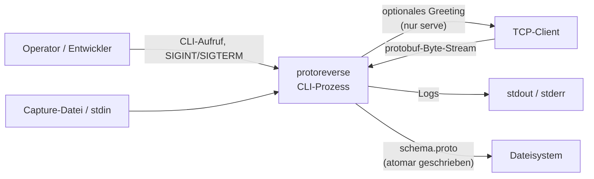

| Externer Partner | Schnittstelle | Richtung | Beschreibung |
| --- | --- | --- | --- |
| Operator | CLI-Argumente, `--help`, Signale | → System | Startet Modus, konfiguriert Framing, Limits, Ausgabe, Greeting |
| TCP-Client | TCP-Socket, rohe Bytes | bidirektional | Sendet geframte protobuf-Nachrichten; empfängt optional ein Greeting |
| Capture-Datei / `stdin` | Byte-Stream | → System | Offline-Eingabe im `analyze`-Modus |
| Dateisystem | Lesen (Greeting-Datei), Schreiben (`.proto`) | bidirektional | Greeting-Payload und atomare Schema-Ausgabe |
| `stdout` / `stderr` | Textzeilen | ← System | Laufzeit-Logs, Fehlermeldungen, Usage |
| Betriebssystem | `SIGINT`/`SIGTERM` | → System | Geordnetes Herunterfahren |

**Nicht im Scope:**

- Entschlüsselung, Dekompression, TLS-Terminierung oder HTTP/2-Verarbeitung
- PCAP/PCAPNG-Parsing (TCP-Payload muss vorher extrahiert werden)
- Replay, Forwarding oder aktive Protokollmanipulation
- Semantische Feldnamen, Enum-Namen, Oneof-Gruppierung oder Mapping-Erkennung
- Persistente Schema-Historie über Prozessläufe hinweg

### 3.2 Technischer Kontext

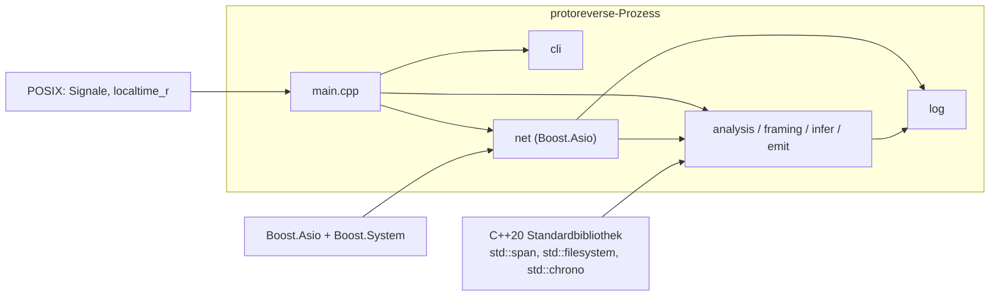

| Technische Schnittstelle | Genutzt von | Zweck |
| --- | --- | --- |
| Boost.Asio `io_context`, `ip::tcp` | `net::Server`, `net::Session` | Asynchrones Accept, Lesen, Schreiben, Timer |
| Boost.Asio `signal_set` | `net::Server` | `SIGINT`/`SIGTERM` |
| Boost.Asio `steady_timer` | `net::Server`, `net::Session` | Poll-Intervall, Idle-Timeout |
| `std::filesystem` | `emit::write_proto_file` | Verzeichnisse anlegen, temporäre Datei, Rename |
| `std::chrono` | CLI, Learner, Server, Session | Timeouts, Laufzeit, Log-Zeitstempel |
| `std::span<const std::uint8_t>` (`ByteSpan`) | Wire, Framing, Analyse | Null-kopierende Sichten auf Puffer |

---

## 4. Lösungsstrategie

Die Architektur folgt einem **pipelineartigen, single-threaded Event-Loop-
Design** mit klar getrennten Verantwortlichkeiten:

1. **CLI-first**: `cli::parse_args` validiert alle Optionen und erzeugt ein
   unveränderliches `Config`-Objekt. Es gibt keine versteckte Konfiguration.
2. **Ein gemeinsamer Analyse-Kern**: `StreamAnalyzer` wird sowohl vom
   TCP-Server als auch vom Offline-Modus verwendet. Dadurch sind
   Framing-Erkennung, Pufferung und Schema-Merging in beiden Modi identisch.
3. **Globales Framing-Lernen**: Ein `FramingLearner` sammelt Stichproben aus
   allen Sessions. Sobald ein Kandidat die Kriterien erfüllt, wird global
   gesperrt. Neue Sessions übernehmen das Ergebnis sofort; bereits verbundene
   Sessions arbeiten ihren Puffer nach.
4. **Heuristik mit Transparenz**: Jeder Kandidat erhält einen Score; jede
   Feldentscheidung erhält eine Konfidenz und einen erklärenden Kommentar im
   generierten `.proto`.
5. **Bounded Resources**: Lernpuffer, Schema-Statistiken, Verschachtelungstiefe
   und Frame-Größen sind explizit begrenzt.
6. **Atomare Ausgabe**: Snapshots werden in eine temporäre Datei geschrieben
   und per Rename ersetzt. Leser sehen nie eine halb geschriebene Datei.
7. **Optionales Greeting**: Der Greeting-Payload wird beim Serverstart einmalig
   validiert und als unveränderlicher `shared_ptr` an alle Sessions
   weitergereicht. Bei explizitem Framing wird auch das Wire-Format vorberechnet;
   bei `auto` wird es erst nach dem Framing-Lock pro Session encodiert. Das
   Greeting wird nicht in die Analyse eingespeist.
8. **Keine externen Protokollabhängigkeiten**: Das Wire-Format wird mit einem
   eigenen Reader/Writer/Validator implementiert. Das hält den Build klein und
   vermeidet Versionskopplung an `protobuf`.

---

## 5. Bausteinansicht

### 5.1 Ebene 1: Gesamtsystem

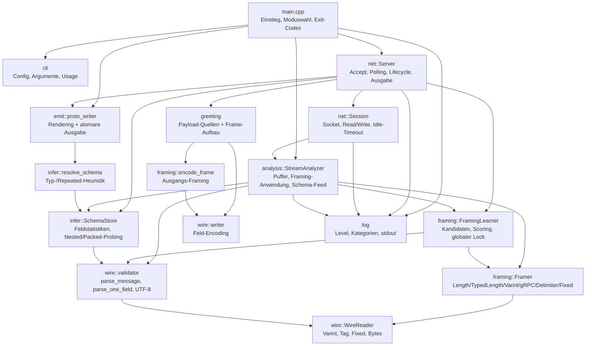

### 5.2 Ebene 2: Bausteine im Detail

#### 5.2.1 `cli` – Konfiguration und Validierung

**Dateien:** `src/cli.hpp`, `src/cli.cpp`

- `Config` bündelt alle Laufzeitparameter mit Defaults.
- `parse_args` unterstützt `--key value` und `--key=value`.
- `print_usage` erzeugt die Hilfe.
- `CliError` wird von `main` gefangen und als Exit-Code `2` behandelt.
- Validierungen umfassen u. a.:
  - Modus `serve`/`analyze` und dazu passende Ein-/Ausgabeoptionen
  - Portbereich, positive Lern-/Frame-Limits
  - gültige Protobuf-Identifier für `--root-name`/`--package`
  - Greeting: genau eine Quelle, `--greeting-framing` erforderlich, `auto`
    erlaubt, `--greeting-type` nur bei typ-präfixiertem oder automatischem
    Framing, nur im `serve`-Modus
  - Byte-Größen (`k`, `m`, `g`, Zweierpotenzen) und Dauern (`ms`, `s`, `m`, `h`)

#### 5.2.2 `net::Server` – Lifecycle und Koordination

**Dateien:** `src/net/server.hpp`, `src/net/server.cpp`

- Besitzt `io_context`, `acceptor`, `signal_set`, `steady_timer`.
- Hält den globalen `FramingLearner`, den gemeinsamen `SchemaStore` und die
  Session-Map.
- Validiert den Greeting-Payload im Konstruktor. Bei explizitem Framing wird
  zusätzlich das Wire-Format vorberechnet; bei `auto` wird nur der Payload
  geteilt und das Wire-Format von der Session nach dem Framing-Lock erzeugt.
- Öffnet/bindet/listen den Acceptor mit `reuse_address`.
- Startet `do_accept`, einen 200-ms-Poll-Timer und den Signal-Wait.
- `poll()` treibt den globalen Framing-Lock voran, verarbeitet verfügbare
  Session-Puffer, prüft Stop-Bedingungen und stößt Autosaves an.
- `stop()` schließt den Acceptor, beendet Sessions, schreibt den finalen
  Snapshot und stoppt den `io_context`.
- Aggregiert Statistik über geschlossene und aktive Sessions.

#### 5.2.3 `net::Session` – Verbindung und Datenfluss

**Dateien:** `src/net/session.hpp`, `src/net/session.cpp`

- Hält Socket, Idle-Timer, Session-ID, Referenzen auf `Config` und
  `FramingLearner`, Callbacks und einen eigenen `StreamAnalyzer`.
- `start()` loggt die Peer-Adresse, armiert den Idle-Timer, sendet bei explizitem
  Framing sofort das vorberechnete Greeting und startet den ersten Read. Bei
  `auto` wird das Greeting nur gesendet, wenn der Learner bereits gelockt ist.
- `do_read()` liest bis zu 16 KiB, füttert den Analyzer, ruft
  `process_available()` und danach den `on_data`-Callback auf und startet den
  nächsten Read.
- `process_available()` verarbeitet gepufferte Frames und prüft anschließend, ob
  ein verzögertes Auto-Greeting gesendet werden kann.
- `maybe_send_delayed_greeting()` verlangt einen gelockten Learner und – außer
  beim Lock direkt nach dem Accept – mindestens einen verarbeiteten Frame.
  Danach wird das gelernte Framing aufgelöst, der Payload encodiert und per
  `send_greeting()` geschrieben. Raw-Fallback überspringt das Greeting mit einer
  Warnung; ein Encoding-Fehler loggt und schließt die Session.
- `send_greeting()` schreibt den vorberechneten Buffer per `async_write`.
  Ein Schreibfehler wird geloggt und schließt die Session.
- `maybe_send_delayed_greeting()` armet nach dem erfolgreichen Senden zusätzlich
  den Alive-Timer, wenn `--alive-message` gesetzt ist. Der Timer feuert nach
  `--alive-interval` und schreibt einen Header-only-Frame
  (`[message type: 4 Byte][length: 4 Byte = 0]`, kein Payload) via
  `encode_frame` mit dem gelernten `FramingSpec`. `--alive-message-type <n>`
  überschreibt dabei den Message-Typ in den ersten 4 Byte. Nach erfolgreichem
  Schreiben wird der Timer erneut armiert. Ohne `--alive-message` bleibt das
  Verhalten unverändert.
- `close()` / `handle_closed()` sind idempotent und benachrichtigen den Server
  genau einmal über `on_closed`. Beide brechen den Alive-Timer ab.
- Ein Idle-Timeout schließt die Session ohne den Gesamtprozess zu beenden.

#### 5.2.4 `analysis::StreamAnalyzer` – gemeinsamer Analyse-Kern

**Dateien:** `src/analysis/stream_analyzer.hpp`, `src/analysis/stream_analyzer.cpp`

- Empfängt Chunks über `feed(ByteSpan)`.
- Zählt empfangene Bytes, überspringt optional `--start-offset`.
- Schreibt optional einen Hexdump der ersten Daten.
- Meldet die Daten an den `FramingLearner` (Sampling).
- Puffert Daten, solange das Framing noch nicht gesperrt ist.
- Nach dem Lock:
  - **Framed**: `Framer::next` liefert Frames; `parse_message` validiert; jedes
    `ParsedMessage` geht an den `SchemaStore`.
  - **RAW**: `parse_one_field` dekodiert fortlaufende Felder; jedes Feld geht
    an `add_raw_field`.
- Ist ein `MessageSink` gesetzt, wird jeder erfolgreich geparste Frame (bzw. im
  RAW-Modus jedes Feld) zusätzlich mit Session, laufender Nummer und optionalem
  Frame-Typ an den Sink übergeben. Der `MessageSpool` schreibt diese Datensätze
  für die spätere JSON-Dekodierung.
- Ist `Config.save_first_message_path` gesetzt, schreibt der Analyzer beim
  ersten erfolgreich verarbeiteten Frame die Frame-Bytes (inkl. Framing-Header)
  in die Datei. Damit lässt sich die erste Client-Nachricht für späterige
  Analysen exportieren (`--save-first-message <file>`).
- `finish()` erzwingt bei Bedarf den Lock und verarbeitet den Restpuffer.
- Fehler werden gezählt und geloggt; im `--strict`-Modus werden sie fatal.
- Begrenzt den Puffer: beim Lernen `max(learning_bytes * 2, 256 KiB)`, danach
  `max_frame + 1024`.

#### 5.2.5 `framing` – Spezifikation, Framer, Learner, Encoder

**Dateien:** `src/framing/spec.hpp/.cpp`, `framer.hpp/.cpp`,
`learner.hpp/.cpp`, `encoder.hpp/.cpp`

**`FramingSpec`** beschreibt eine Variante:

| Feld | Bedeutung |
| --- | --- |
| `kind` | `Auto`, `Raw`, `Length`, `Varint`, `Grpc`, `Newline`, `Nul`, `Fixed`, `TypedLength` |
| `width` | Präfixbreite 1/2/4/8 bei `Length`/`TypedLength` |
| `big_endian` | Endianness des Längenfelds bei `Length`/`TypedLength` |
| `includes_header` | Präfixwert enthält den Header selbst; bei `TypedLength` den gesamten Typ+Längen-Header |
| `fixed_size` | Frame-Größe bei `Fixed` |
| `type_width` | Breite des Typfelds 1/2/4/8 bei `TypedLength` |
| `type_big_endian` | Endianness des Typfelds bei `TypedLength` |
| `type_value` | Typwert, der beim Encodieren (Greeting) geschrieben wird |

`parse_framing` akzeptiert u. a. `auto`, `raw`, `varint`, `grpc`, `newline`,
`nul`, `fixed:<n>`, `len:<w>:<be|le>[:incl|:payload]`,
`type:<tw>:<be|le>+len:<w>:<be|le>[:incl|:payload]` sowie die Kurzform
`type<n>+len<n>:<be|le>[:incl|:payload]` (Typfeld dann Big-Endian) und
`u8`, `u16be`, `u32le`, `u64be` usw.

Ein `TypedLength`-Frame hat die Form
`[type:type_width][length:width][payload]`. Das Typfeld ist für die Analyse
opak; dadurch dürfen auf einer Verbindung unterschiedliche Nachrichtentypen
auftreten. `:incl` bedeutet hier, dass das Längenfeld den kompletten
Typ+Längen-Header enthält.

**Framer** sind Strategien mit `next(buffer, consumed, frame, error)`. Sie
halten keinen Stream-Fortschritt (der Aufrufer verwaltet den Puffer), liefern
`Complete`, `NeedMore` oder `Error` und erzwingen `max_frame`.
`last_frame_type()` liefert bei `TypedLength` den Typwert des zuletzt
gelieferten Frames; andere Framer geben `std::nullopt` zurück. Dieser Wert
landet optional im JSON-Datensatz.

**`FramingLearner`**:

- Hält pro Session eine Stichprobe bis `learning_bytes`; global höchstens
  `max_memory` (Default 4 MiB).
- Erzeugt 23 Kandidaten: 14 Längen-Präfix-Varianten (1/2/4/8 Byte,
  inkl./exkl. Header, Endianness), 4 typ-präfixierte Varianten
  (`type_width=4`, `width=4`, Längen-Endianness und `payload`/`incl`),
  `varint`, `grpc`, `newline`, `nul`, `raw`. `fixed:<n>` ist nur als
  explizite Vorgabe verfügbar und kein Auto-Kandidat. Bei `TypedLength` ist die
  Endianness des Typfelds für die Frame-Grenzen irrelevant und wird daher nicht
  variiert.
- Bewertet jeden Kandidaten durch Framing und Parsen der Stichprobe. Eine
  unvollständige Stichprobe ist kein Fehler: `probe_frame` liefert Prefix,
  deklarierte Länge, Header-Größe und benötigte Bytes, ohne den Frame zu
  konsumieren.
- Evidenzstufen pro Kandidat: Prefix lesbar, erster Tag valide, vollständiger
  Frame geparst, zweite Frame-Grenze bestätigt. Daraus entsteht ein
  `structural`-Wert (0.0–1.0).
- Score:

```text
score = 0.20 * coverage
      + 0.15 * frame_score
      + 0.20 * wire_type_consistency
      + 0.10 * plausibility
      + 0.25 * structural
      + 0.10 * prior
score *= zero_frame_penalty
score *= 0.85, falls weniger als 2 Frames
```

  `frame_score` sättigt bereits nach `min(learning_frames, 4)` Frames. RAW
  verwendet einen eigenen Score-Zweig und zählt Felder nicht als Frames.
- Early Lock: Der Learner sperrt sofort, wenn der Prefix plus erster gültiger
  Tag starke Evidenz liefert oder ein vollständiger Frame geparst wurde und
  die Margin zum zweitbesten Kandidaten ausreicht. Bei einer
  `payload`/`incl`-Tie-Breakung ohne vollständigen Frame entscheidet der
  Prior; die Konfidenz bleibt niedrig.
- Sperrt sonst, wenn `learning_timeout` abgelaufen ist, `learning_bytes`
  erreicht sind oder der beste Kandidat `learning_frames` Frames erreicht.
  Ohne gültigen Kandidaten fällt der Learner auf `Raw` zurück.
- Die Framing-Konfidenz kombiniert Score, Sample-Faktor und Margin-Faktor;
  Raw wird auf maximal 0.80, eine reine Prefix-Entscheidung auf 0.70 und eine
  Ein-Frame-Entscheidung auf 0.85 begrenzt.
- `--early-lock off` deaktiviert nur den Early Lock; die Schwellen für
  `learning_bytes`, `learning_frames` und `learning_timeout` bleiben aktiv.

**`encode_frame`** ist das Gegenstück für das Greeting: Es erzeugt aus einem
unframten Payload die konfigurierte Framing-Repräsentation (Raw, Length,
TypedLength, Varint, gRPC, Newline, NUL, Fixed). Bei `TypedLength` wird zuerst
`type_value` mit `type_width`/`type_big_endian` geschrieben, danach das
Längenfeld. `Auto` wird abgelehnt.

#### 5.2.6 `wire` – Wire-Format

**Dateien:** `src/wire/reader.hpp/.cpp`, `validator.hpp/.cpp`,
`writer.hpp/.cpp`

- `WireReader` liest Varints, Tags, Fixed32/64 und Längenfelder mit
  `ReadResult::{Ok, NeedMore, Invalid}`.
- `parse_one_field` erkennt unvollständige Felder (`complete=false`) und
  unterstützt die Wire-Typen 0, 1, 2 und 5. Gruppen (3/4) werden abgelehnt.
- `parse_message` parst eine vollständige Nachricht und meldet Truncation.
- `is_valid_utf8` / `is_printable_utf8` liefern Signale für die
  String-Heuristik.
- `writer` erzeugt Varints, Tags und Felder für das Greeting.
- `ParseLimits` begrenzen Felderzahl, Tiefe und Länge.

#### 5.2.7 `infer` – Statistik und Typauflösung

**Dateien:** `src/infer/schema.hpp/.cpp`, `type_resolver.hpp/.cpp`

- `SchemaStore` merged jede beobachtete Nachricht in einen Baum aus
  `MessageSchema`/`FieldStats`.
- Pro Feld werden Wire-Typen, Zahlenstatistiken, Längen, UTF-8-/Printable-
  Treffer, Nested-Parse-Erfolge und Packed-Dekodierungen gezählt.
- Probiert length-delimited Felder zusätzlich als verschachtelte Nachricht und
  als gepackte Zahlen (Varint, fixed32, fixed64).
- `resolve_schema` erzeugt `ResolvedModel`/`ResolvedMessage`/`ResolvedField`:
  - Feldnamen synthetisch: `field_<n>`
  - verschachtelte Messages: `<Parent>_Field<n>`
  - reservierte Feldnummern 19000–19999 werden nicht emittiert
  - `repeated`, wenn `occurrences > messages_seen` (außer bei packed)
  - Typwahl nach Wertebereich, 0/1-Muster, Float-/Double-Plausibilität,
    UTF-8-Druckbarkeit, Nested-/Packed-Erfolgsquoten
  - Konfidenz = Typkonfidenz × Sample-Faktor
- RAW-Modus ergänzt explizite Caveats zur Kardinalität.

#### 5.2.8 `emit` – Rendering, Spooling und atomare Ausgabe

**Dateien:** `src/emit/proto_writer.hpp/.cpp`, `src/emit/message_spool.hpp/.cpp`,
`src/emit/json_writer.hpp/.cpp`

- `render_proto` erzeugt Kommentare (Framing, Sessions, Bytes, Frames,
  Limitierungen), `syntax`, `package` und die Messages. Die Root-Message wird
  zuerst ausgegeben.
- Proto3 ist Default; `--proto2` ergänzt `optional` bei singulären Feldern.
- `write_proto_file` legt fehlende Verzeichnisse an, schreibt in eine
  temporäre Datei im Zielverzeichnis, flusht und benennt sie atomar um.
- `MessageSpool` implementiert `MessageSink` und schreibt Frames binär in eine
  temporäre Datei (`session`, `index`, optionaler Frame-Typ, Payload). Nach der
  Analyse wird der Spool zum Lesen geöffnet; der Destruktor entfernt ihn.
- `write_messages_json` dekodiert den Spool mit dem finalen `ResolvedModel` und
  schreibt JSON Lines, ebenfalls über eine temporäre Datei mit atomarem Rename.

#### 5.2.9 `decode` – Wire-zu-JSON-Dekodierung

**Dateien:** `src/decode/message_decoder.hpp/.cpp`

- `make_decode_schema` baut aus dem `ResolvedModel` eine Namenssuche für die
  Root- und Nested-Messages.
- `render_message_json` erzeugt genau ein JSON-Objekt pro Message:
  `session`, `index`, optional `type`, `fields`.
- Feldnamen sind `field_<n>` wie im generierten Proto. Nested Messages werden
  zu Objekten, repeated/packed zu Arrays.
- `int64`, `uint64` und `fixed64` werden als Dezimalstrings ausgegeben, um
  Genauigkeitsverluste in JSON-Parsern zu vermeiden. `int32`, `uint32` und
  `fixed32` bleiben JSON-Zahlen.
- `string` wird als JSON-String escaped; `bytes`, ungültiges UTF-8 und
  inkompatible Wire-Typen fallen auf einen Hexdump bzw. ein Rohobjekt
  `{"wire_type":...,"value"/"raw":...}` zurück.
- `--json-hexdump-bytes` begrenzt binäre Werte; `0` bedeutet unbegrenzt.

#### 5.2.10 `greeting` – optionales Server-Greeting

**Dateien:** `src/greeting/greeting.hpp/.cpp`

- `GreetingConfig` hält genau eine Quelle (`file`, `hex` oder `fields`), ein
  optionales `FramingSpec` (inkl. `Auto`) und `message_type` für typ-präfixierte
  Frames (`--greeting-type`, Default 0).
- `build_greeting_payload` validiert die Quellen und erzeugt den ungeframten
  protobuf-Payload.
- Feldmodus: `<field-number>:<type>=<value>`, Feldnummer 1–536870911.
- Unterstützte Skalare: `int32`, `int64`, `uint32`, `uint64`, `sint32`,
  `sint64`, `bool`, `string`, `bytes`, `fixed32`, `fixed64`, `float`,
  `double`.
- `resolve_greeting_framing` liefert das explizite Framing unverändert oder
  übernimmt bei `Auto` das gelernte Framing. Ein Raw-Fallback wird abgelehnt,
  weil er keine Serverantwort beschreibt.
- `encode_greeting_wire` hängt ein aufgelöstes Framing an einen bereits
  vorbereiteten Payload an und überträgt `message_type` in
  `FramingSpec::type_value`.
- `encode_greeting_wire(message_type, framing, payload, …)` ist der Startpfad für
  `--reply-with-first-message`: Der Greeting-Payload wird dabei nicht aus einer
  konfigurierten Quelle, sondern aus der zuletzt verarbeiteten ersten Client-Message
  (`StreamAnalyzer::first_message_payload()` plus Frame-Typ) bezogen.
- `build_greeting_wire` ist der Startpfad für explizites Framing und lehnt
  `Auto` ab. Der Payload wird im `Server`-Konstruktor immer validiert; bei
  explizitem Framing wird zusätzlich das Wire-Format als
  `shared_ptr<const std::vector<uint8_t>>` geteilt. Bei `auto` teilt der Server
  nur den Payload und die Session encodiert nach dem Lock. Bei
  `--reply-with-first-message` überspringt die Session das konfigurierte
  Greeting-Payload und encodiert stattdessen die erste Client-Message.
- `--alive-message` aktiviert zusätzlich zum (bzw. alternativ zum) Server-Greeting
  einen periodischen Keep-alive: Nach dem Senden des Greetings wird ein
  Header-only-Frame (`[message type: 4 Byte][length: 4 Byte = 0]`, kein Payload)
  nach `--alive-interval` (Default 30 s) gesendet und der Timer danach erneut
  armiert. Voraussetzung ist `--greeting-framing auto` oder
  `--reply-with-first-message`, da das Framing für den Reply bekannt sein muss.
  `--alive-message-type <n>` überschreibt den Message-Typ in den ersten 4 Byte
  des Headers (Default: gelernter Typ).

#### 5.2.11 `util` und `log`

- `util/hexdump` erzeugt eine kompakte Hexdarstellung für Diagnose- und
  JSON-Ausgaben. `max_bytes == 0` bedeutet unbegrenzt; gekürzte Ausgaben enden
  mit ` ...`.
- `log` ist ein thread-sicherer, levelgefilterter Logger nach `stdout`:
  `HH:MM:SS.mmm [LEVEL] kategorie nachricht`.
- Der Log-Level wird global über `set_log_level` gesetzt; `Off` deaktiviert
  die Ausgabe vollständig.

### 5.3 Zentrale Datenstrukturen

| Typ | Ort | Rolle |
| --- | --- | --- |
| `Config` | `cli.hpp` | Vollständige, validierte Laufzeitkonfiguration |
| `GreetingConfig` | `greeting.hpp` | Quelle und Framing des Server-Greetings |
| `FramingSpec` | `framing/spec.hpp` | Eine konkrete oder automatische Framing-Variante |
| `CandidateScore` | `framing/learner.hpp` | Bewertung eines Framing-Kandidaten |
| `ParseLimits` | `wire/validator.hpp` | Obergrenzen für Felder, Tiefe, Länge |
| `ParsedField` / `ParsedMessage` | `wire/validator.hpp` | Ergebnis der Wire-Dekodierung |
| `FieldStats` / `MessageSchema` | `infer/schema.hpp` | Aggregierte Beobachtungen pro Feld/Nachricht |
| `ResolvedField` / `ResolvedMessage` / `ResolvedModel` | `infer/type_resolver.hpp` | Ausgabe-Modell für das `.proto`-Rendering |
| `ProtoOptions` | `emit/proto_writer.hpp` | Metadaten für den Datei-Header |
| `MessageRecord` / `MessageSink` | `analysis/message_sink.hpp` | Persistenz-Hook für erfolgreich geparste Messages |
| `MessageSpool` | `emit/message_spool.hpp` | Temporäre binäre Ablage für die spätere Dekodierung |
| `DecodeSchema` / `DecodeOptions` | `decode/message_decoder.hpp` | Aufgelöstes Schema und Optionen für Wire-zu-JSON |
| `JsonOptions` | `emit/json_writer.hpp` | Hexdump-Limit für die JSONL-Ausgabe |

### 5.4 Abhängigkeiten zwischen Bausteinen

| Von | Nach | Art |
| --- | --- | --- |
| `main` | `cli`, `net`, `analysis`, `emit` | Komposition |
| `net::Server` | `net::Session`, `FramingLearner`, `SchemaStore`, `greeting`, `emit` | Nutzung/Koordination |
| `net::Session` | `StreamAnalyzer` | Komposition |
| `StreamAnalyzer` | `FramingLearner`, `Framer`, `validator`, `SchemaStore`, `MessageSink` | Nutzung |
| `FramingLearner` | `Framer`, `validator` | Nutzung |
| `Framer` / `validator` | `WireReader` | Nutzung |
| `SchemaStore` | `validator`, `WireReader` | Nutzung |
| `emit` | `resolve_schema`, `decode`, `std::filesystem` | Nutzung |
| `decode` | `validator`, `type_resolver`, `hexdump` | Nutzung |
| `greeting` | `encode_frame`, `wire::writer` | Nutzung |

Es gibt keine zyklischen Abhängigkeiten auf Modulebene. Die zentrale
Datenflussrichtung ist:

```text
Bytes → WireReader → validator → SchemaStore → resolve_schema → emit
                 ↘ Framer ↗                 ↘ MessageSink → Spool → decode → JSONL
```

---

## 6. Laufzeitsicht

### 6.1 Serverstart und Greeting-Vorbereitung

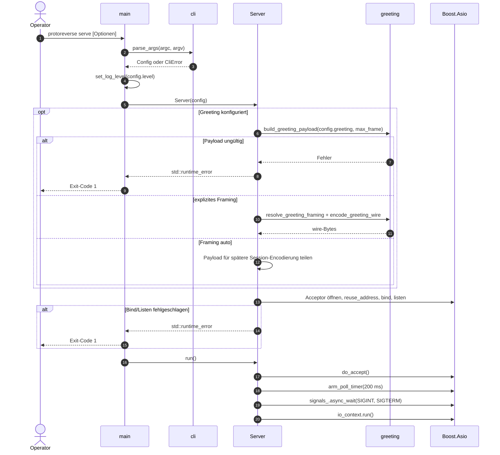

Der Greeting-Payload wird also **vor** dem ersten Accept vollständig validiert.
Bei explizitem Framing entsteht das Wire-Format ebenfalls vorab; bei `auto`
bleibt es bis zum Framing-Lock offen. Ein Konfigurationsfehler verhindert den
Serverstart.

### 6.2 Verbindungsaufbau, Greeting und Datenanalyse

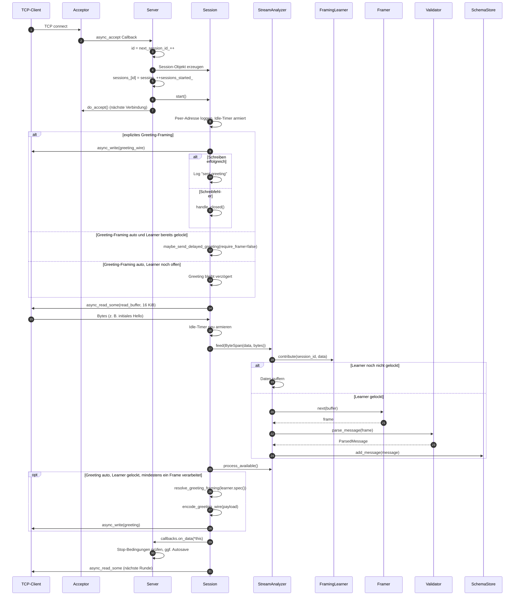

Wichtig: Lesen und Schreiben laufen asynchron und unabhängig. Das Greeting
blockiert den ersten Read nicht. Es wird **nicht** in den Analyzer eingespeist
und beeinflusst daher weder Framing-Erkennung noch Schema. Ein verzögertes
Greeting wird auch vom 200-ms-`poll()`-Pfad erneut geprüft, falls der Learner
erst nach dem letzten Read gelockt wurde.

### 6.3 Globales Framing-Lernen über mehrere Sessions

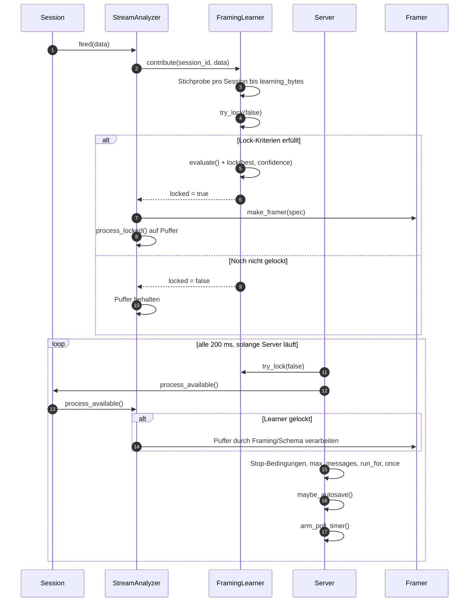

Sobald der globale Lock besteht, verwenden **alle** Sessions dieselbe
`FramingSpec`. Neue Sessions lernen nicht erneut; bereits verbundene Sessions
arbeiten ihre gepufferten Bytes mit dem gewählten Framing ab. Der Early Lock
kann bereits im ersten `contribute()` greifen, wenn Prefix und erster Tag
ausreichen; der 200-ms-Poll ist dafür nicht erforderlich.

### 6.4 Offline-Analyse (`analyze`)

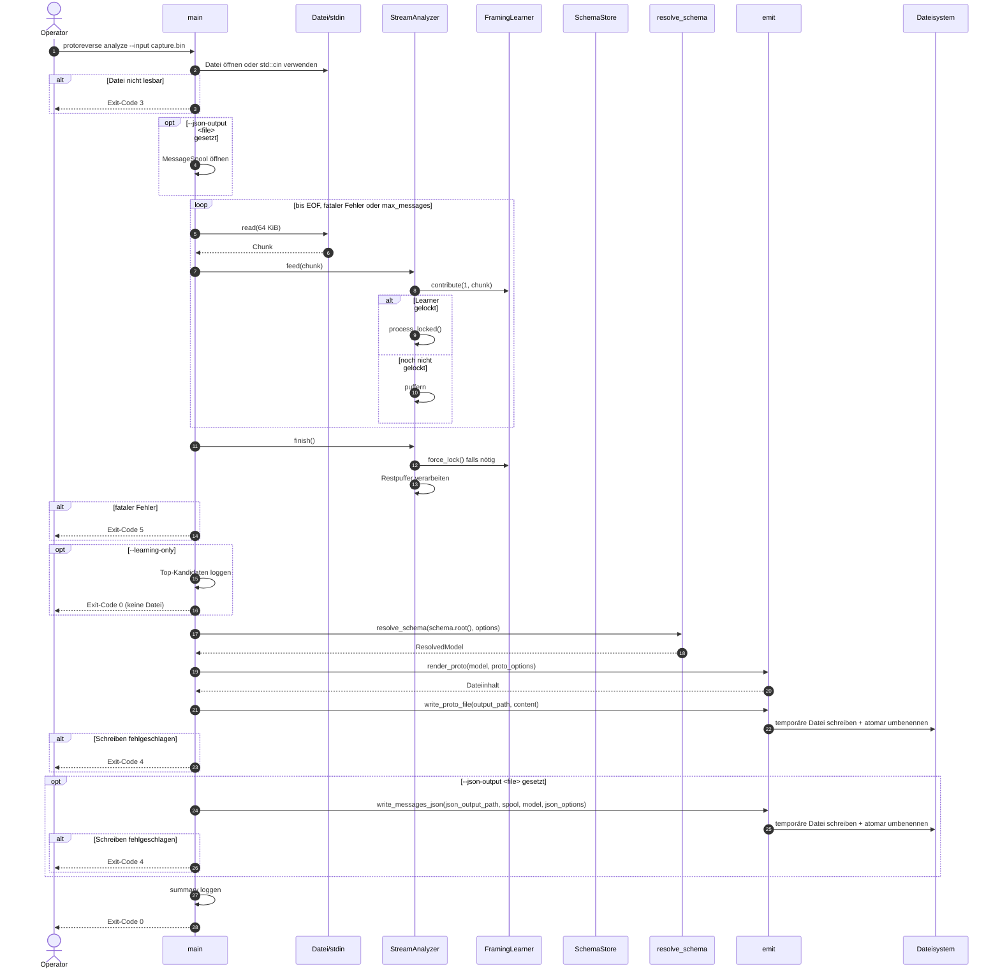

### 6.5 Autosave im Serverbetrieb

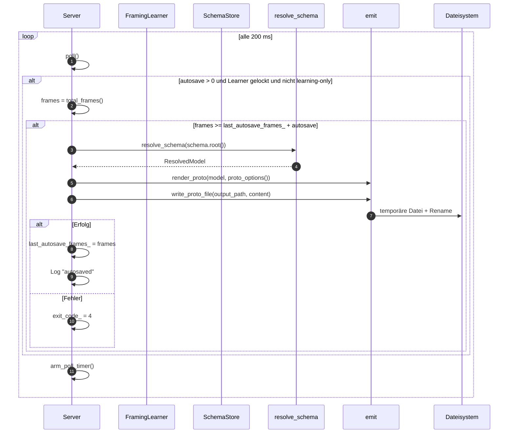

Autosaves sind Snapshots: Sie ersetzen die Zieldatei atomar, enthalten aber
jeweils den aktuellen Schema-Stand. Der finale Snapshot erfolgt beim Stoppen.

Autosave schreibt ausschließlich die `.proto`-Datei. Die JSON-Ausgabe (`--json-output`)
wird nicht über Autosave aktualisiert, sondern separat beim Serverstoppen über die
finalen, in der Message-Sammlung (`MessageSpool`) enthaltenen Frames geschrieben.

### 6.6 Geordnetes Herunterfahren

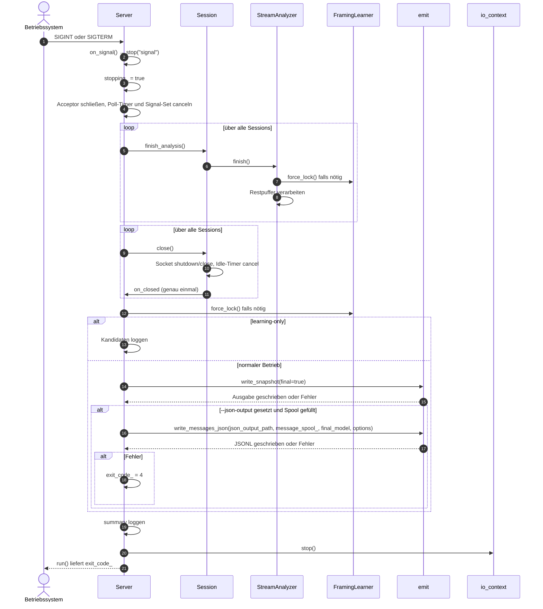

Weitere Stop-Auslöser sind `--once` (erste Session beendet),
`--max-messages`, `--run-for`, abgeschlossenes Lernen im
`--learning-only`-Modus und ein fataler Parse-Fehler im `--strict`-Modus.

### 6.7 Fehlerbehandlung im laufenden Betrieb

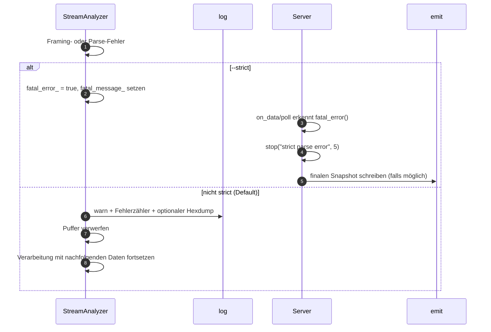

Weitere Fehlerpfade:

- **Accept-Fehler**: werden geloggt; der Acceptor wird erneut armiert, damit
  transiente Fehler (z. B. `EMFILE`) den Server nicht dauerhaft taub machen.
- **Read-Fehler / EOF**: nur die betroffene Session wird geschlossen.
- **Greeting-Schreibfehler**: nur die betroffene Session wird geschlossen.
- **Auto-Greeting bei Raw-Fallback**: Warnung, Greeting wird übersprungen; die
  Session analysiert weiter.
- **Greeting-Encoding-Fehler**: Fehler wird geloggt, die betroffene Session wird
  geschlossen.
- **Idle-Timeout**: Session wird geschlossen, der Server läuft weiter.
- **Ausgabefehler**: `exit_code_` wird auf 4 gesetzt; der Server läuft weiter
  und versucht es beim nächsten Autosave/finalen Write erneut.

### 6.8 Zustandsmodelle

**Session:**

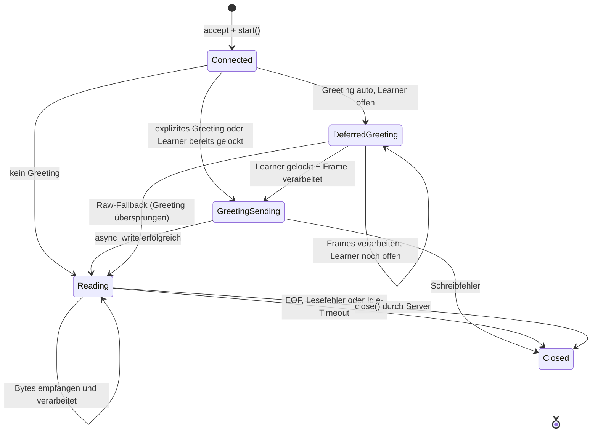

**FramingLearner:**

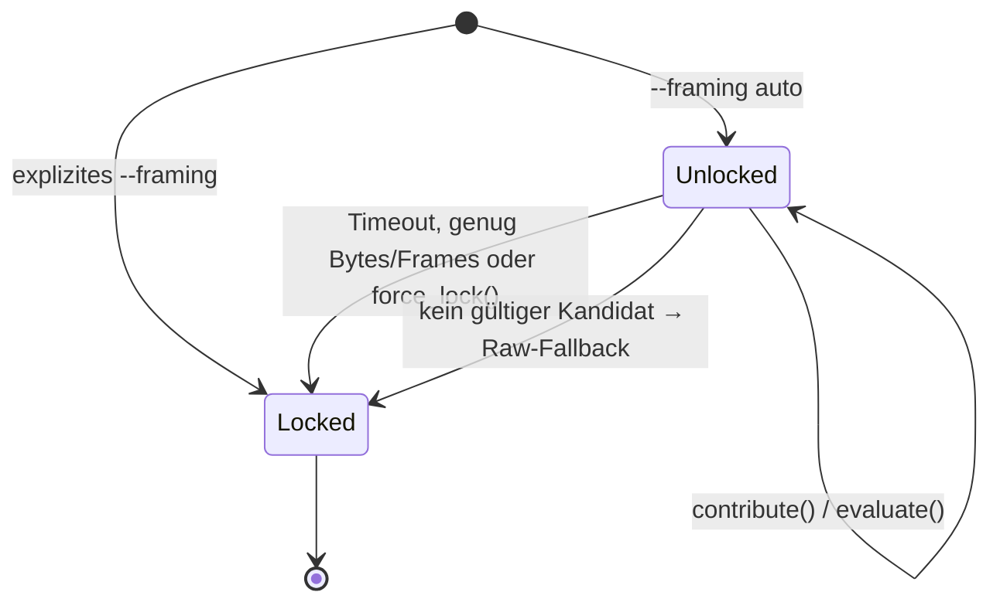

---

## 7. Verteilungssicht

`protoreverse` ist ein einzelner, im Vordergrund laufender Prozess. Es gibt
keine verteilten Komponenten, keine Datenbank und keine externen
Netzwerkaufrufe außer dem TCP-Listener. Die Ausgabe erfolgt in das lokale
Dateisystem.

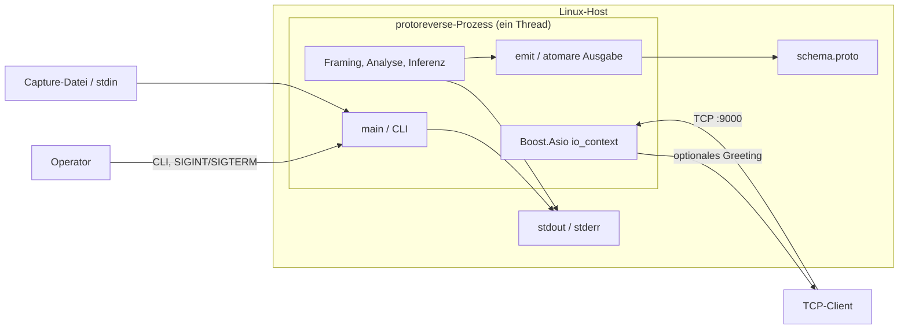

| Aspekt | Ausprägung |
| --- | --- |
| Prozessmodell | Ein Prozess, ein Thread (`io_context.run()` im Hauptthread) |
| Netzwerk | Ein TCP-Listener, mehrere gleichzeitige Verbindungen |
| Persistenz | Keine; nur `.proto`-Snapshots |
| Ausgabe | Atomarer Dateiaustausch im Zielverzeichnis |
| Logs | `stdout`; Fehler der CLI zusätzlich `stderr` |
| Skalierung | Vertikal; begrenzt durch CPU des einen Threads und Socket-Puffer |
| Hochverfügbarkeit | Nicht vorgesehen; Neustart erforderlich |
| Verteilung | Ein einzelnes Binary; optional vollständig statisch gelinkt |

### 7.1 Statisches Deployment

Für den Betrieb auf einem anderen System kann `protoreverse` vollständig
statisch gelinkt werden. Dadurch entfallen Laufzeitabhängigkeiten auf
`libstdc++`, `libgcc`, `libc` und `libm` der Zielmaschine:

```sh
cmake -S . -B build-static -DCMAKE_BUILD_TYPE=Release -DPROTOREVERSE_STATIC=ON
cmake --build build-static -j
```

Voraussetzung sind die statischen Runtime-Bibliotheken des Toolchains
(Fedora/RHEL: `libstdc++-static`, `glibc-static`). CMake prüft dies beim
Konfigurieren mit einem Testlink und bricht mit einer handlungsorientierten
Meldung ab, falls die Bibliotheken fehlen. Die Alternative
`PROTOREVERSE_STATIC_RUNTIME=ON` linkt nur `libstdc++`/`libgcc` statisch und
belässt `libc` dynamisch. Beide Optionen schließen sich gegenseitig aus;
`PROTOREVERSE_STATIC` wird unter macOS nicht unterstützt.

Ein statisches glibc-Binary bleibt an die Kernel-ABI gebunden. Es sollte auf
einer Distribution gebaut werden, deren glibc und Kernel nicht neuer sind als
die der ältesten Zielumgebung. Für vollständig portable Artefakte ist ein
musl-Toolchain-Build oder ein Container die robustere Variante.

---

## 8. Querschnittskonzepte

### 8.1 Konfiguration und CLI

Alle Parameter sind in `Config` (`src/cli.hpp`) definiert und werden in
`parse_args` validiert. Wichtige Defaults:

| Parameter | Default | Bedeutung |
| --- | --- | --- |
| `--bind` | `0.0.0.0` | Bind-Adresse |
| `--port` | `9000` | TCP-Port |
| `--output` | `schema.proto` | Zielpfad |
| `--framing` | `auto` | Framing-Erkennung oder Override (inkl. `type<n>+len<n>:<be\|le>`) |
| `--start-offset` | `0` | Bytes am Sessionanfang überspringen |
| `--greeting-type` | `0` | Typwert für typ-präfixierte Greetings |
| `--learning-bytes` | `64 KiB` | Stichprobengröße pro Session |
| `--learning-frames` | `32` | Frame-Ziel für den Lock |
| `--learning-timeout` | `2 s` | Maximale Lernzeit |
| `--early-lock` | `balanced` | Sofortige Entscheidung bei starker Evidenz; `off` deaktiviert sie |
| `--max-frame` | `16 MiB` | Maximale Frame-/Feldlänge |
| `--max-messages` | `0` | 0 = unbegrenzt |
| `--run-for` | `0` | 0 = unbegrenzt |
| `--idle-timeout` | `60 s` | Session-Timeout; 0 deaktiviert |
| `--autosave` | `1000` | Snapshot alle n Frames; 0 = aus |
| `--proto2` / `--proto3` | proto3 | Ausgabesyntax |
| `--package` | `inferred` | Paketname |
| `--root-name` | `ClientMessage` | Name der Root-Message |
| `--log-level` | `info` | trace/debug/info/warn/error/off |
| `--strict` | aus | Fataler Abbruch bei Parsefehlern |
| `--json-output` | aus | Zielpfad für JSON Lines; `--json-hexdump-bytes` setzt das Hexdump-Limit |
| `--save-first-message` | aus | Schreibt die erste verarbeitete Message (Frame) in die Datei |
| `--reply-with-first-message` | aus | Server antwortet mit der ersten Client-Message statt konfiguriertem Greeting-Payload |
| `--alive-message` | aus | Server sendet periodisch einen 8-Byte-Header-Keep-alive (`--alive-interval`, Default 30 s) |
| `--alive-interval` | `30 s` | Intervall für den Alive-Keep-alive |
| `--alive-message-type` | gelernter Typ | Message-Typ in den ersten 4 Byte des Alive-Headers; erfordert `--alive-message` |

Intern gilt zusätzlich `max_learning_memory = 4 MiB` als globale Obergrenze für
Lernstichproben.

### 8.2 Logging

- Format: `HH:MM:SS.mmm [LEVEL] kategorie nachricht`; die Kategorie wird auf
  11 Zeichen aufgefüllt, einige Level-Namen enthalten ein Füllzeichen
  (z. B. `[INFO ]`)
- Ausgabe: `stdout`, per `fflush` sofort sichtbar
- Level: `Trace`, `Debug`, `Info`, `Warn`, `Error`, `Off`
- Thread-Sicherheit: globaler Mutex, obwohl der Server single-threaded ist
- Kategorien: `net`, `learn`, `session`, `input`, `output`, `server`,
  `summary`, `analyze`
- Der Lernprozess loggt die ausgewählte Framing-Spec, die Top-Kandidaten mit
  Score/Frames/Coverage und einen Ambiguous-Hinweis bei geringem Margin.

### 8.3 Fehlerbehandlung und Exit-Codes

| Exit-Code | Ursache |
| --- | --- |
| `0` | Erfolg (inkl. `--learning-only`) |
| `1` | Unbehandelte `std::exception` (z. B. ungültiges Greeting, Bind-Fehler) |
| `2` | CLI-Fehler (`CliError`) |
| `3` | Eingabedatei im `analyze`-Modus nicht lesbar |
| `4` | Schreiben der Ausgabedatei fehlgeschlagen |
| `5` | Fataler Parsing-/Framing-Fehler im `--strict`-Modus |

Im nicht-strikten Modus werden Parsefehler gezählt, geloggt und durch
Verwerfen des aktuellen Puffers behandelt. Im strikten Modus wird der Prozess
mit Code 5 beendet.

### 8.4 Nebenläufigkeit und Lebenszyklen

- Der gesamte Server läuft in **einem** `io_context`-Thread. Dadurch gibt es
  keine Datenrennen auf `FramingLearner`, `SchemaStore` oder der Session-Map.
- Sessions werden als `std::shared_ptr<Session>` gehalten. Asynchrone
  Operationen nehmen eine eigene `shared_ptr`-Kopie, damit die Session bis zum
  Callback-Abschluss lebt.
- `Session::close()` und `Session::handle_closed()` sind idempotent und
  benachrichtigen den Server über `notified_closed_` genau einmal.
- Der Logger verwendet einen Mutex, falls Logging künftig aus mehreren Threads
  erfolgt.
- Der Analyzer liest erst den nächsten Chunk, wenn der aktuelle verarbeitet
  ist. Das erzeugt natürliche Backpressure; der Kernel-Socket-Puffer hält
  weitere Daten vor.

### 8.5 Speicher- und Ressourcenlimits

| Ressource | Limit | Ort |
| --- | --- | --- |
| Felder pro Nachricht | 1.000.000 | `ParseLimits` |
| Verschachtelungstiefe | 64 | `ParseLimits` |
| Länge eines Längenfeldes | `max_frame` (Default 16 MiB) | `ParseLimits` |
| Frame-Größe | `max_frame` | Framer |
| Lernstichprobe pro Session | `learning_bytes` (Default 64 KiB) | `FramingLearner` |
| Lernstichprobe global | 4 MiB | `FramingLearner` |
| Lernpuffer pro Session | `max(2 × learning_bytes, 256 KiB)` | `StreamAnalyzer` |
| Analysepuffer nach Lock | `max_frame + 1024` | `StreamAnalyzer` |
| Nested-Parse-Versuche | 512 pro Feld | `SchemaStore` |
| Packed-Parse-Versuche | 512 pro Feld | `SchemaStore` |
| Probe-Bytes für Nested/Packed | 64 KiB | `SchemaStore` |
| Distinct-Werte pro Statistik | 64 | `SchemaStore` |
| String-Samples | 8 pro Feld, max. 128 Bytes | `SchemaStore` |
| Temporärer Message-Spool | Datei im Temp-Verzeichnis (nicht RAM-gepuffert) | `MessageSpool` |
| Idle-Timeout | 60 s (konfigurierbar) | `Session` |

### 8.6 Framing-Lernheuristik

Der Learner bewertet Kandidaten ausschließlich anhand der Stichproben. Ein
Kandidat gilt als ungültig, wenn das Framing oder das Parsen eines Frames
fehlschlägt. Eine unvollständige Stichprobe ist dagegen ein gültiger
Teilbefund: Prefix, deklarierte Länge und erster Tag werden ausgewertet, auch
wenn noch kein Frame komplett ist. Inkonsistente Wire-Typen für dieselbe
Feldnummer senken den Score, machen den Kandidaten aber nicht automatisch
ungültig. Die Bewertung belohnt:

- **Coverage**: Anteil der dekodierten Bytes an der Stichprobe
- **Frame-Score**: erreichte Frame-Anzahl relativ zu `min(learning_frames, 4)`
- **Wire-Typ-Konsistenz**: gleiche Feldnummern mit gleichem Wire-Typ
- **Plausibilität**: mindestens zwei Frames
- **Structural Evidence**: Prefix lesbar, erster Tag valide, vollständiger
  Frame, zweite Frame-Grenze
- **Prior**: vorsichtige Bevorzugung von `len:4:be`, danach weitere
  Längenpräfixe, `varint` und `gRPC`
- **Zero-Penalty**: leere Frames sind verdächtig

Der Early Lock greift, sobald der beste Kandidat mindestens einen vollständigen
Frame mit gültigem Tag und ausreichender Margin besitzt. Bei nur einem Prefix
plus erstem Tag reicht die strukturelle Evidenz, sofern der Vorsprung zum
zweitbesten Kandidaten eindeutig ist. Die nicht auflösbare Ähnlichkeit zwischen
`payload`- und `incl`-Längenpräfix wird über den Prior zugunsten von `payload`
entschieden; die Konfidenz bleibt dabei bewusst niedrig.

Bei fast gleichen Scores wird eine Ambiguous-Warnung geloggt. Der Anwender
kann dann `--framing` explizit setzen. Ein explizites Framing sperrt den
Learner sofort mit Konfidenz 1.0.

### 8.7 Schema-Inferenz und Konfidenz

Die Inferenz ist bewusst heuristisch und wird im generierten `.proto`
dokumentiert:

- **Varint**: 0/1-Muster → `bool`; hohes Bit → `int64`; kleiner Bereich →
  `int32`; größerer Bereich → `uint32`/`int64`.
- **fixed32/fixed64**: plausible Float-/Double-Muster und große Werte →
  `float`/`double`; sonst `fixed32`/`fixed64`.
- **Length-delimited**: valides druckbares UTF-8 → `string`; stabile
  Nested-Parses → verschachtelte Message; gepackte Zahlen → `repeated` +
  `[packed = true]`; sonst `bytes`.
- **Repeated**: `occurrences > messages_seen`, außer bei gepackten Feldern.
- **Konfidenz**: Typkonfidenz × `sample_factor(count)`, geclampt auf
  `0.0..0.99`; jede Ausgabezeile nennt Beobachtungszahlen und Alternativen.
- **Reservierte Feldnummern** 19000–19999 werden nicht emittiert.

### 8.8 Atomare Ausgabe

`write_proto_file`:

1. Legt fehlende Elternverzeichnisse an.
2. Erzeugt eine temporäre Datei im **selben** Verzeichnis:
   `<ziel>.tmp.<steady_clock-Zähler>`.
3. Schreibt den vollständigen Inhalt und flusht.
4. Benennt die temporäre Datei atomar auf das Ziel um.
5. Entfernt die temporäre Datei bei Fehlern.

Dadurch sehen Leser entweder den alten oder den neuen vollständigen Stand, nie
eine halb geschriebene Datei.

`write_messages_json` folgt demselben Schema: temporäre Datei im Zielverzeichnis,
vollständiger Schreibvorgang, Flush und atomicen Rename. Die temporäre Datei heißt
`<ziel>.tmp.<steady_clock-Zähler>` und wird bei Fehlern entfernt.

### 8.9 Sicherheit

- Der TCP-Server bietet **keine Authentifizierung, keine Verschlüsselung und
  keine Autorisierung**. Er sollte nur in vertrauenswürdigen Netzen oder hinter
  einem Proxy betrieben werden.
- Eingabedaten werden strikt gegen `ParseLimits` validiert; Längen werden vor
  dem Allokieren geprüft.
- Es werden keine Daten ausgeführt, keine Plugins geladen und keine
  Netzwerkverbindungen nach außen aufgebaut.
- Ressourcen-DoS ist teilweise begrenzt (Frame-Größe, Lernspeicher,
  Idle-Timeout), aber viele gleichzeitige Verbindungen oder sehr viele
  unterschiedliche Feldnummern können weiterhin Speicher/CPU binden.
- Das Lesen der Greeting-Datei erfolgt über den angegebenen Pfad; der Prozess
  benötigt die entsprechenden Dateisystemrechte.

### 8.10 Portabilität

- Der Code nutzt POSIX-Funktionen (`localtime_r`, Signale) und ist daher für
  Linux/POSIX ausgelegt.
- CMake unterscheidet MSVC (`/W4`) und GCC/Clang
  (`-Wall -Wextra -Wpedantic`).
- `BOOST_ASIO_NO_DEPRECATED` verhindert die Nutzung veralteter Asio-APIs.
- `std::filesystem` und `std::chrono` sind C++20-Standard und plattformneutral.

---

## 9. Architekturentscheidungen

| ID | Entscheidung | Begründung | Konsequenzen |
| --- | --- | --- | --- |
| ADR-001 | Boost-only, kein `protobuf`/`protoc` | Kleiner Build, keine Codegenerierung, volle Kontrolle über Wire-Parsing | Eigene Reader/Writer/Validator; kein Schema-Compiler |
| ADR-002 | C++20 + CMake | Moderne Sprachmittel, breite Toolchain-Unterstützung | Compiler-Anforderungen; `std::span`/`bit_cast` |
| ADR-003 | Automatisches Framing-Lernen mit globalem Lock | Framing ist vorab oft unbekannt; ein gemeinsames Schema erfordert einheitliche Grenzen | Heuristik kann irren; Override und Konfidenz nötig |
| ADR-004 | Single-threaded Asio-Event-Loop | Einfache Synchronisation, reproduzierbare Verarbeitungsreihenfolge, keine Datenrennen | CPU-bound Parsing blockiert alle Sessions; vertikale Skalierung begrenzt |
| ADR-005 | Gemeinsamer `SchemaStore` über alle Sessions | Ein Schema statt N Einzelschemata; bessere Statistik | Session-übergreifende Vermischung möglich; keine Trennung pro Client |
| ADR-006 | Heuristische Typinferenz mit Konfidenz und Kommentaren | Protobuf ist nicht selbstbeschreibend; Unsicherheit muss sichtbar bleiben | Ergebnis ist best-effort, nicht garantiert korrekt |
| ADR-007 | RAW-Modus als Fallback | Manche Sender schreiben Felder ohne Framing | Kardinalität/Repeated nicht zuverlässig; explizite Warnungen |
| ADR-008 | Atomare Dateiausgabe + Autosave | Leser dürfen nie Teil-Dateien sehen; lange Läufe brauchen Zwischenstände | Zusätzliche temporäre Datei; Rename-Semantik des Dateisystems nötig |
| ADR-009 | Optionales Greeting mit explizitem oder automatischem Framing | Manche Clients senden erst ein Hello und warten dann auf eine Servernachricht | Explizites Framing sendet sofort; `auto` sendet verzögert nach Framing-Lock und mindestens einem Frame; Raw-Fallback überspringt; Payload einmalig validiert |
| ADR-010 | CLI-only-Konfiguration | Kein Config-Parser, keine versteckten Defaults, einfache Automatisierung | Viele Optionen; keine Profil-/Dateikonfiguration |
| ADR-011 | Kein persistenter Zustand | Prozess ist einfach und zustandslos startbar | Neustart verliert Schema; kein Resume/Append |
| ADR-012 | Greeting-Feldmodus nur für Skalare | Vermeidet einen `.proto`-Parser und bleibt Boost-only | Nested/Enum/Map nur über vorbereitete Bytes |
| ADR-013 | Early Framing Lock auf Basis von Prefix und erstem Tag | Viele Clients senden nur wenige Bytes; das bisherige 64-KiB/32-Frame/2-s-Kriterium verzögert die Analyse | Prefix-only und `payload`/`incl` bleiben ambig; Prior, Margin und niedrige Konfidenz nötig; `--early-lock off` als Ausweg |

**Verworfene Alternativen:**

- **`protobuf`-Bibliothek einbinden**: würde `protoc`, Descriptor-Handling und
  eine große Laufzeitabhängigkeit einführen; widerspricht der Boost-only-Vorgabe.
- **Framing pro Session lernen**: würde bei mehreren Clients zu
  inkonsistenten Schemata und doppeltem Lernaufwand führen.
- **Mehrere Worker-Threads**: würde Locks um Learner/Schema und komplexere
  Session-Lebenszyklen erfordern; für den aktuellen Anwendungsfall nicht nötig.
- **In-Place-Schreiben der Ausgabe**: könnte bei Absturz oder Parallelzugriff
  halbe Dateien hinterlassen; atomarer Rename ist robuster.
- **Greeting-Framing sofort automatisch erkennen**: vor dem ersten Client-Byte
  nicht möglich; deshalb wird `auto` erst nach dem Framing-Lock und einem
  vollständigen Frame aufgelöst, statt ein geratenes Framing zu senden.

---

## 10. Qualitätsanforderungen

### 10.1 Qualitätsbaum

```mermaid
flowchart TB
    Q["Qualität von protoreverse"]
    Q --> K["Korrektheit"]
    Q --> R["Robustheit"]
    Q --> P["Performance"]
    Q --> E["Erklärbarkeit"]
    Q --> B["Betreibbarkeit"]

    K --> K1["Framing-Erkennung"]
    K --> K2["Wire-Validierung"]
    K --> K3["Schema-Inferenz"]

    R --> R1["Begrenzte Ressourcen"]
    R --> R2["Fehlertoleranz"]
    R --> R3["Atomare Ausgabe"]
    R --> R4["Sauberes Shutdown"]

    P --> P1["Streaming-Verarbeitung"]
    P --> P2["Begrenzter Speicher"]
    P --> P3["Geringe Latenz pro Chunk"]

    E --> E1["Konfidenzwerte"]
    E --> E2["Caveats und Alternativen"]
    E --> E3["Kandidaten-Logging"]

    B --> B1["CLI-Konfiguration"]
    B --> B2["Logging"]
    B --> B3["Signalbehandlung"]
    B --> B4["Ein Binary"]
```

### 10.2 Qualitätsszenarien

| ID | Qualitätsziel | Stimulus | Erwartete Reaktion | Messkriterium |
| --- | --- | --- | --- | --- |
| QS-1 | Korrektheit Framing | 30 Nachrichten mit `len:4:be` | Learner wählt `len:4:be`, Confidence ≥ 0.9, alle Frames werden geparst | 30/30 Frames, 0 Fehler |
| QS-1a | Frühe Framing-Erkennung | Client sendet nur Prefix plus ersten Tag (5 Byte) von `len:4:be` | Learner sperrt `len:4:be` ohne 2-s-Timeout; Confidence ist bei `payload`/`incl`-Ambiguität niedrig | Lock nach einem `contribute()`, Warnung bei Ambiguität |
| QS-2 | Korrektheit Wire | Verschachtelte Nachricht mit Varint/Fixed/Length-Feldern | Alle Felder werden korrekt dekodiert, Nested Message erkannt | Schema enthält erwartete Feldnummern/Typen |
| QS-3 | Robustheit malformed | Ein Frame mit ungültigem Wire-Typ, kein `--strict` | Warnung, Fehlerzähler++, Verarbeitung läuft weiter | Prozess endet mit 0, Fehler im Log |
| QS-4 | Robustheit malformed | Derselbe Fall mit `--strict` | Kontrollierter Stop, finaler Snapshot falls möglich | Exit-Code 5 |
| QS-5 | Begrenzter Speicher | Kontinuierlicher Stream über Stunden | Puffer bleibt durch `max_frame + 1024` bzw. Lernlimits begrenzt | Kein unbegrenztes Wachstum |
| QS-6 | Atomare Ausgabe | Leser öffnet `schema.proto` während eines Autosaves | Leser sieht alten oder neuen vollständigen Stand | Keine partiellen Dateien |
| QS-7 | Greeting | Client wartet auf Servernachricht | Client erhält genau ein Greeting pro Verbindung, danach normale Analyse | Greeting-Bytes exakt, Frames werden analysiert |
| QS-7a | Verzögertes Greeting | Client sendet erst ein Hello und wartet dann auf `--greeting-framing auto` | Nach dem Lock und dem ersten Frame erhält der Client das Greeting im gelernten Framing | Typ- und Längenbytes entsprechen dem gelernten Framing |
| QS-8 | Erklärbarkeit | Unsichere Typentscheidung | Feldkommentar nennt Konfidenz und Alternativen | Kommentar im `.proto` vorhanden |
| QS-9 | Betreibbarkeit | `SIGINT` während laufender Sessions | Finaler Snapshot, Summary, Exit 0 | Datei vorhanden, Log-Summary |
| QS-10 | Override | `--framing len:4:be` | Kein Lernen, sofortige Verarbeitung, Confidence 1.0 | Log "using explicit framing" |
| QS-11 | Offline-Determinismus | Gleiche Eingabedatei zweimal | Gleiches Schema (bis auf Zeit/Timing) | Dateiinhalt identisch |

---

## 11. Risiken und technische Schulden

| ID | Risiko / Schuld | Auswirkung | Wahrscheinlichkeit | Gegenmaßnahme / Status |
| --- | --- | --- | --- | --- |
| R-1 | Heuristik wählt falsches Framing | Falsche Frames, unbrauchbares Schema | Mittel | Kandidaten-Logging, Confidence, `--framing`-Override, Ambiguous-Warnung |
| R-2 | Falsche Typinferenz | Schema kompiliert, semantisch aber falsch | Hoch | Konfidenz + Alternativen + Caveats; manuelle Nachbearbeitung |
| R-3 | RAW-Modus vermischt Nachrichten | `repeated`/Kardinalität unzuverlässig | Hoch bei RAW | Explizite Warnungen in Datei und Feldkommentaren |
| R-4 | Delimiter-Framing (Newline/NUL) trifft Bytes im Payload | Falsche Frame-Grenzen | Mittel | Dokumentation; Length-Prefix bevorzugen |
| R-5 | Keine TLS-/Auth-Schicht | Unbefugter Zugriff, Datenabfluss | Hoch bei öffentlichem Bind | Nur vertrauenswürdige Netze; Proxy/TLS extern |
| R-6 | Single-Thread-CPU-Sättigung | Langsame Verarbeitung, Session-Stau | Mittel bei hoher Last | Begrenzte Puffer, Idle-Timeout; horizontale Skalierung nicht vorgesehen |
| R-7 | Speicherwachstum durch viele Feldnummern/Nested-Nodes | Steigender RSS | Mittel | Begrenzte Distinct-Werte, Probe-Limits; keine harte Gesamtgrenze |
| R-8 | Kein Sanitizer-Lauf in der Umgebung | Unentdecktes UB möglich | Mittel | ASan/UBSan in CI nachrüsten, sobald `libasan` verfügbar |
| R-9 | Greeting nur für Skalare | Nested/Enum/Map nicht direkt konfigurierbar | Niedrig | `--greeting-file` / `--greeting-hex` |
| R-10 | gRPC nur Data-Frames | HTTP/2, Compression, Trailer nicht unterstützt | Mittel | Dokumentierte Limitierung; externes Tooling nötig |
| R-11 | Kein PCAP-Input | Zusätzlicher Extraktionsschritt | Niedrig | Dokumentiert; TCP-Payload vorab extrahieren |
| R-12 | Keine Persistenz/Resume | Neustart verliert Schema | Niedrig | Autosave/Snapshots; kein Merge über Läufe |
| R-13 | Feldnummern 19000–19999 werden übersprungen | Schema unvollständig bei exotischen Protokollen | Niedrig | Bewusste Protobuf-Konvention; Kommentar in Ausgabe |
| R-14 | Keine harte Begrenzung der Verbindungszahl | Datei-Deskriptoren/Thread-loses Asio kann erschöpfen | Mittel | Betriebliche Limits (ulimit, Firewall); Accept-Fehler werden toleriert |
| R-15 | Gemischte Nachrichtentypen landen in einem Root-Schema | Felder verschiedener Typen werden vermischt | Mittel bei typ-präfixierten Protokollen | Typfeld bleibt opak; Schema pro Typ ist nicht implementiert (dokumentiert) |
| R-16 | Auto-Erkennung typ-präfixierter Frames nur für 4-Byte-Typ + 4-Byte-Länge | Andere Breiten werden nicht automatisch erkannt | Niedrig | Explizites `--framing type<...>+len<...>` |
| R-17 | Auto-Greeting wartet auf einen vollständigen Frame | Client, der nur ein unvollständiges Hello sendet, erhält kein Greeting | Niedrig | Explizites `--greeting-framing` verwenden; Learner-Timeout und Raw-Fallback sind geloggt |

---

## 12. Glossar

| Begriff | Bedeutung |
| --- | --- |
| **arc42** | Strukturvorlage für Architekturdokumentation in zwölf Abschnitten |
| **Boost.Asio** | Header-only Netzwerk-/Event-Loop-Bibliothek; hier für TCP, Timer und Signale |
| **ByteSpan** | `std::span<const std::uint8_t>`; nicht-besitzende Sicht auf Puffer |
| **Framing** | Abgrenzung einzelner protobuf-Nachrichten im Byte-Stream (z. B. Längenpräfix) |
| **FramingSpec** | Struktur, die eine konkrete Framing-Variante beschreibt |
| **Framer** | Strategieobjekt, das aus einem Puffer den nächsten Frame extrahiert |
| **Learner** | Komponente, die Framing-Kandidaten bewertet und global sperrt |
| **Wire-Format** | Binäres protobuf-Format aus Tags, Varints, Fixed32/64 und Längenfeldern |
| **Varint** | Base-128-Variablenlängen-Encoding für Ganzzahlen |
| **Tag** | Kombination aus Feldnummer und Wire-Typ, gebildet aus `field << 3` und `wire_type` |
| **Wire-Typ** | 0 = Varint, 1 = fixed64, 2 = length-delimited, 5 = fixed32 |
| **Packed** | Kompakte Kodierung wiederholter numerischer Felder in einem Längenfeld |
| **Nested Message** | Als Längenfeld kodierte, eingebettete protobuf-Nachricht |
| **RAW-Modus** | Analyse eines kontinuierlichen Felderstroms ohne Frame-Grenzen |
| **Konfidenz** | Heuristischer Sicherheitswert (0–0.99) für eine Inferenzentscheidung |
| **Autosave** | Periodischer Schema-Snapshot während des Serverbetriebs |
| **Greeting** | Optionales, serverseitig gesendetes protobuf-Payload nach Verbindungsaufbau |
| **Session** | Eine TCP-Verbindung inkl. eigenem Analyzer und Puffer |
| **Snapshot** | Vollständiger `.proto`-Stand zu einem Zeitpunkt |
| **Atomarer Rename** | Dateisystemoperation, die eine temporäre Datei unteilbar ersetzt |

---

## Anhang A: Quellcode-Landkarte

| Pfad | Inhalt |
| --- | --- |
| `src/main.cpp` | Einstieg, Moduswahl, Offline-Schleife, Exit-Codes |
| `src/cli.*` | `Config`, Argumentparser, Validierung, Usage |
| `src/log.*` | Level, Zeitstempel, thread-sicheres Logging |
| `src/net/server.*` | Accept, Polling, Stop-Bedingungen, Autosave, Finalisierung |
| `src/net/session.*` | Socket-Lesen/-Schreiben, Greeting, Idle-Timeout, Lifecycle |
| `src/analysis/stream_analyzer.*` | Chunk-Verarbeitung, Puffer, Framing-Anwendung, Fehler |
| `src/framing/spec.*` | `FramingSpec`, Parser und String-Repräsentation |
| `src/framing/framer.*` | Length/Varint/gRPC/Delimiter/Fixed-Framer |
| `src/framing/learner.*` | Kandidaten, Scoring, globaler Lock |
| `src/framing/encoder.*` | Ausgangs-Framing für das Greeting |
| `src/greeting/greeting.*` | Greeting-Quellen, Feld-Encoding, Frame-Aufbau |
| `src/wire/reader.*` | Varint/Tag/Fixed/Bytes-Leser und Decoder |
| `src/wire/validator.*` | `parse_message`, `parse_one_field`, UTF-8-Prüfung |
| `src/wire/writer.*` | Varint-/Tag-/Feld-Writer |
| `src/infer/schema.*` | Feldstatistiken, Nested-/Packed-Probing, Merging |
| `src/infer/type_resolver.*` | Typ-, Repeated- und Konfidenz-Heuristik |
| `src/emit/proto_writer.*` | `.proto`-Rendering und atomare Ausgabe |
| `src/util/hexdump.*` | Hexdump für Diagnose |
| `tests/test_main.cpp` | Unit-/Integrationstests für Wire, Framing, Schema, Greeting, CLI |

## Anhang B: Typische Betriebsabläufe

```sh
# Offline mit automatischer Framing-Erkennung
./build/protoreverse analyze --input capture.bin --output schema.proto

# TCP-Server mit explizitem Framing
./build/protoreverse serve --bind 0.0.0.0 --port 9000 --framing len:4:be

# Nur Framing-Kandidaten inspizieren
./build/protoreverse analyze --input capture.bin --learning-only

# Client wartet auf ein Greeting (explizites Framing)
./build/protoreverse serve --port 9000 \
  --greeting-framing len:4:be \
  --greeting-field 4:int32=2 \
  --greeting-field 5:int32=0 \
  --greeting-field 6:int32=2 \
  --greeting-field 2:string=2.0.2 \
  --greeting-field 3:string=vendor-x

# Client sendet zuerst ein Hello; Greeting folgt im gelernten Framing
./build/protoreverse serve --port 9000 \
  --greeting-framing auto \
  --greeting-type 2 \
  --greeting-field 4:int32=2 \
  --greeting-field 2:string=2.0.2
```

## Anhang C: Verifikation

| Prüfung | Kommando | Erwartung |
| --- | --- | --- |
| Build | `cmake -S . -B build -DCMAKE_BUILD_TYPE=Debug && cmake --build build -j2` | Erfolgreich |
| Unit-/Integrationstests | `./build/protoreverse_tests` | `all tests passed` |
| CTest | `ctest --test-dir build --output-on-failure` | `100% tests passed` |
| Statischer Build | `cmake -S . -B build-static -DCMAKE_BUILD_TYPE=Release -DPROTOREVERSE_STATIC=ON && cmake --build build-static -j` | `file` meldet `statically linked`, `ldd` meldet `not a dynamic executable` |
| Hilfe | `./build/protoreverse --help` | Alle Modi/Optionen sichtbar |
| Greeting-Integration | Server mit `--greeting-field`, Client liest Greeting | Exakte Wire-Bytes, danach Frames analysiert |
| Verzögertes Greeting | Session-Test mit Hello-Frames und `--greeting-framing auto` | Greeting erst nach Lock/Frame, Wire-Bytes im gelernten Framing |

---

*Dieses Dokument beschreibt den Stand vom 2026-11-05. Es ist bewusst
implementierungsnah gehalten, damit Architektur und Quellcode synchron bleiben.*
